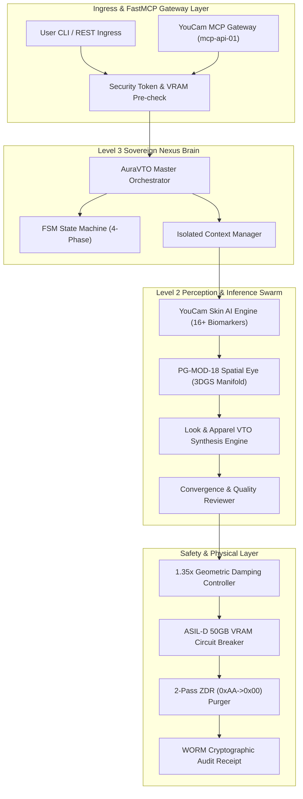
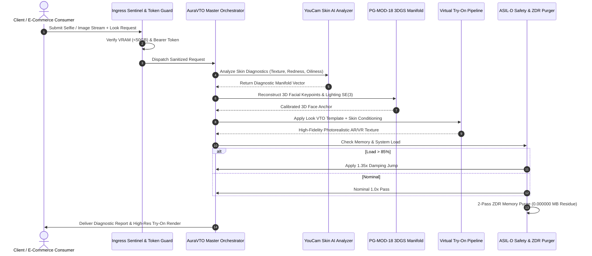
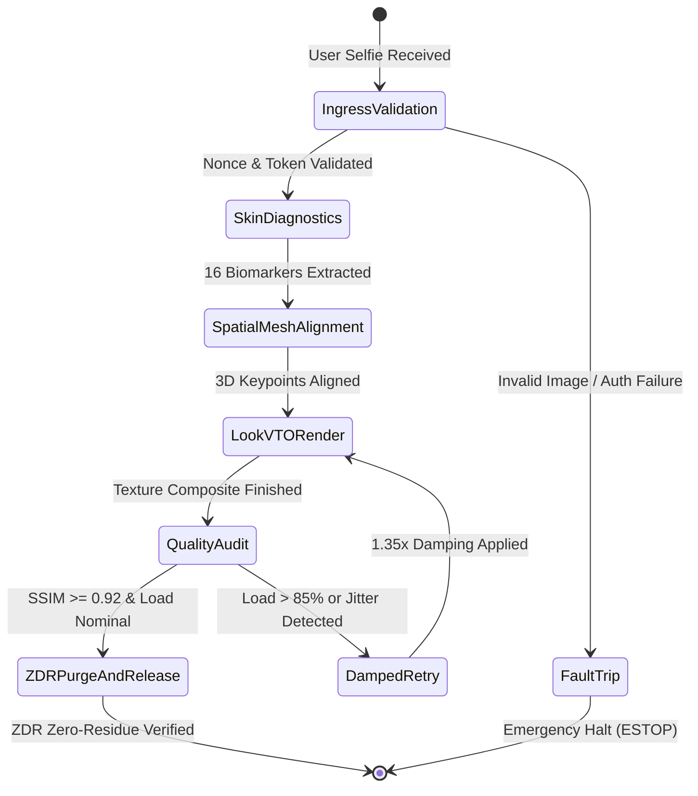
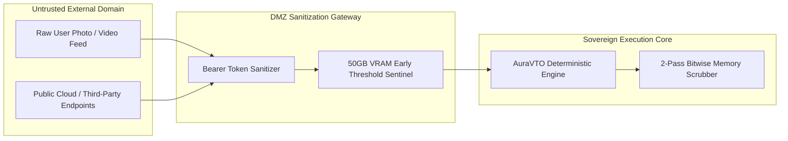

# SPEC_01 :: PHANToM GRID AuraVTO & SkinSense AI Technical Whitepaper
> Autonomous Agentic Skin Diagnostics & Spatial AR/VR Virtual Try-On Engine
> Sovereign Constitution v6.4.0 | Rule 65 (Tri-Standard Architecture)

---

## 1. System Overall Topology Diagram (Diagram 01)

## 2. Full Lifecycle Sequence Diagram (Diagram 02)

## 3. Finite State Machine Diagram (Diagram 03)

## 4. Security Boundary & Meltdown Guard Diagram (Diagram 04)

## 5. Table 1: Resource Defense & Invariant Matrix
| Component ID | Subsystem Target | Hardware Ceilings | Failsafe Trip Condition | Purge Invariant |
| :--- | :--- | :---: | :---: | :---: |
| **DEF-01** | Ingress Token Gateway | < 10ms Latency | Malformed Nonce / Auth Failure | Immediate Socket Drop |
| **DEF-02** | YouCam Skin Diagnostic Hub | 16 Biomarkers | Response Latency > 1500ms | Failover to Local Heuristic |
| **DEF-03** | PG-MOD-18 3DGS Manifold | 4000 Gaussians | Mesh Drift > 1.2mm | Dynamic Rigidity Anchor |
| **DEF-04** | Damping Controller | 1.35x Damping Scalar | Load Ratio > 0.85 | Automatic Backoff Step |
| **DEF-05** | Memory Meltdown Breaker | 50.0 GB VRAM | Memory Footprint >= 50.0 GB | Instant ESTOP Interruption |
| **DEF-06** | Zero Data Residue (ZDR) | 2-Pass Bitwise Scrub | Residual Footprint > 0.000000 MB | Cryptographic Vault Lockdown |
